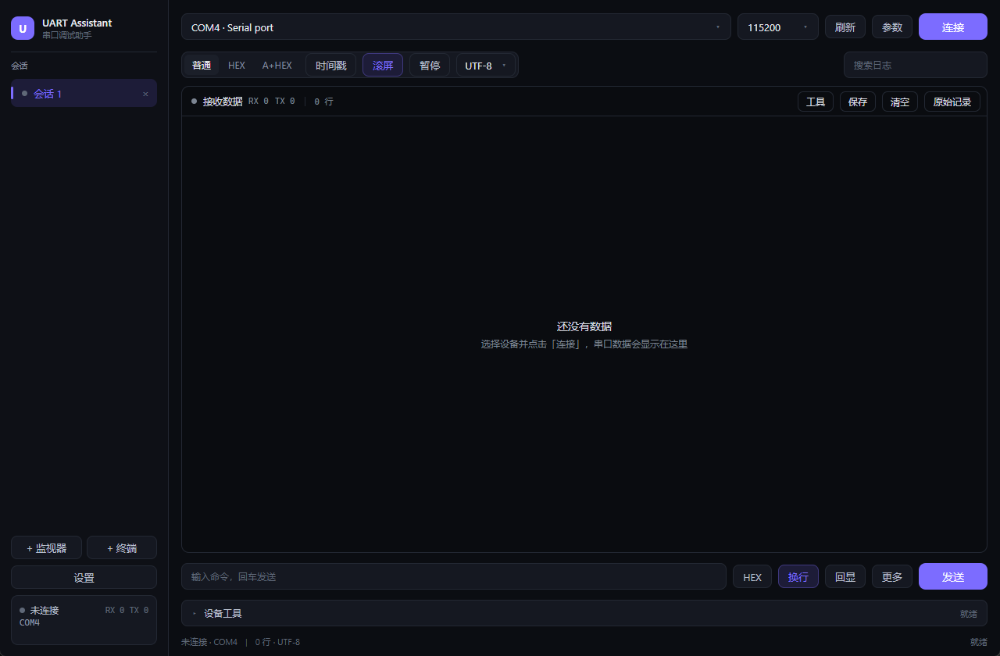

# UART Assistant

面向 Windows / Linux 嵌入式与 MCU 开发的轻量串口调试工具。

界面用 Rust + WebView2（Chromium）渲染，文字走系统子像素抗锯齿，观感与 VS Code / 浏览器一致；发布产物是一个约 0.9 MB 的单文件可执行程序，Windows 上依赖系统自带的 Microsoft Edge WebView2 运行时，不需要 Python、Qt 或 .NET。



## 功能

- 多标签会话：监视器 / 终端两种会话，新建、关闭、切换、双击重命名，每个标签独立连接与收发统计
- 设备发现：Windows 枚举 COM 口并显示 VID/PID、产品名；Linux 优先使用 `/dev/serial/by-id`、`/dev/serial/by-path` 稳定别名；每 2 秒后台热插拔扫描
- 串口参数：波特率、数据位、停止位、校验位、流控，按设备记忆
- 监视器：普通 / HEX / ASCII+HEX 三种显示模式，时间戳、自动滚屏、暂停、自动换行（续行缩进，可切换为不换行横向滚动）、编码切换（UTF-8 / GB18030 / GBK / Big5 / Shift_JIS / Latin-1）、行数上限、搜索与关键词高亮、清空与保存日志；日志区 Ctrl + 滚轮缩放字号（9–32 px，随配置保存）
- 终端：VT100/ANSI 解析、SGR 颜色、光标闪烁、回滚缓冲，可直接作为目标板 Linux 串口控制台
- 后台原始 RX 记录：在显示限流之前写入原始字节，每 10 MiB 自动分卷
- 断线自动重连：1.5 s 起指数退避，最长 30 s；检测到设备热插拔后立即探测
- 发送区：回车发送、HEX 发送、自动加换行、TX 回显、循环发送（间隔可调）、↑/↓ 调出发送历史、宏命令快捷按钮
- 工具面板：DTR / RTS 线路控制、STM32 复位与 Bootloader 时序、XModem 128 字节 / 1K 文件发送（CRC 协商、进度与取消）
- 主题：深色 / 浅色、4 种强调色、界面文字颜色（预设 + 自定义 `#RRGGBB`），设置面板内即时预览，日志与终端配色随主题切换
- 配置持久化：上次端口与参数、每设备独立档案（最多 40 条）、宏命令、监视器偏好、窗口尺寸

更多截图见 [`docs/screenshots`](docs/screenshots)：[浅色](docs/screenshots/monitor-light.png)、[终端](docs/screenshots/terminal.png)、[参数](docs/screenshots/params.png)、[设置](docs/screenshots/settings.png)。

## 构建与运行

需要 Rust（建议 1.85 或更新）：

```bash
cargo build --release
```

产物：

```text
target/release/uart-assistant        # Linux
target/release/uart-assistant.exe    # Windows
```

Windows 需要 WebView2 运行时（Windows 11 自带；Windows 10 一般随 Edge 安装）。缺失时程序会弹出提示而不是静默退出。

Linux 需要 `webkit2gtk-4.1`、`gtk-3`、`libsoup-3.0` 的开发包与 `libudev-dev`：

```bash
sudo apt install libwebkit2gtk-4.1-dev libgtk-3-dev libsoup-3.0-dev libjavascriptcoregtk-4.1-dev libudev-dev pkg-config
```

运行串口通常要把用户加入 `dialout` 组后重新登录。

## 配置

```text
Windows  %APPDATA%\uart-assistant\config.json
Linux    ~/.config/uart-assistant/config.json
```

WebView2 的缓存放在 `%LOCALAPPDATA%\uart-assistant\webview2`，不会在程序目录里生成 `*.WebView2` 文件夹。

## 项目结构

```text
uart_assistant/
├── src/
│   ├── main.rs              # 窗口、WebView、事件泵、深色标题栏、窗口尺寸记忆
│   ├── state.rs             # 会话、串口事件、日志/终端推送、命令分发
│   ├── theme.rs             # 深浅色板、强调色、主题 JSON
│   ├── port.rs / session.rs # 设备枚举、串口线程、重连与热插拔
│   ├── monitor.rs / terminal.rs # 监视器格式化与 VT100/ANSI 状态机
│   ├── raw_log.rs / xmodem.rs   # 原始分卷记录与 XModem 协议
│   └── config.rs / types.rs     # 配置持久化与共享类型
├── ui/index.html            # 界面（HTML/CSS/JS，编译时内嵌进可执行文件）
├── docs/screenshots/        # 界面截图
├── build.rs / app.ico       # Windows 图标与版本信息
└── .github/workflows/ci.yml # Windows / Ubuntu 双平台构建
```

## 开发验证

```bash
cargo check
cargo test
cargo build --release
```

CI 在 `windows-latest` 与 `ubuntu-latest` 上执行 `cargo check`、`cargo test` 与 `cargo build --release`，并上传两个平台的可执行文件。

## 当前实现边界

- 终端以等宽网格和前景色渲染，ANSI 背景色用前景色/反色近似；未提供鼠标右键复制粘贴与全局 Ctrl 快捷键
- 日志搜索在前端完成，范围是当前已加载的行（受“行数上限”限制）
- 多行发送暂未放进界面（发送框为单行）；循环发送、宏、断线自动重连开关已支持
- Linux 下的 WebKitGTK 渲染与 Windows 的 WebView2 存在细微差异（字体、滚动条），布局按 1280×840 设计

## 许可

项目代码按 [MIT License](LICENSE) 发布。

界面依赖 [wry](https://github.com/tauri-apps/wry) / WebView2，串口依赖 [serialport](https://github.com/serialport/serialport-rs)，均为 MIT / Apache-2.0 许可。
